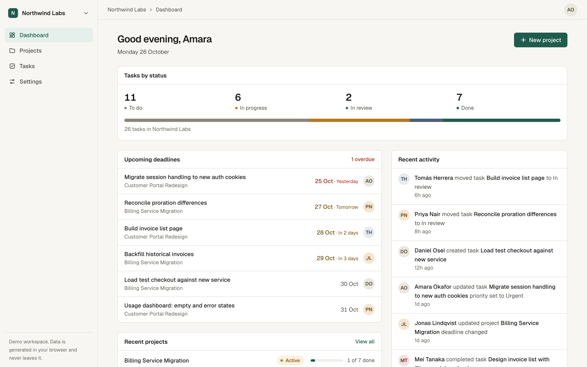
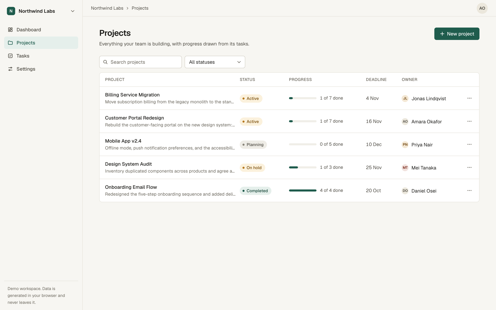
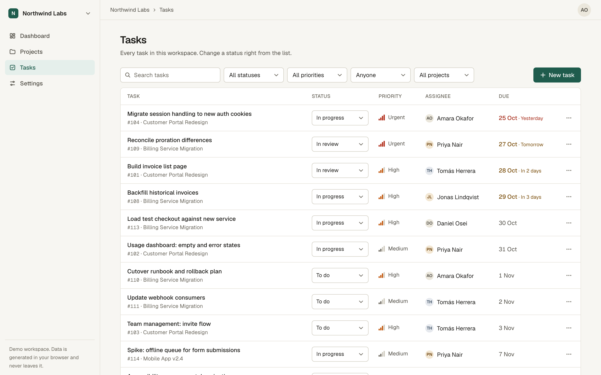
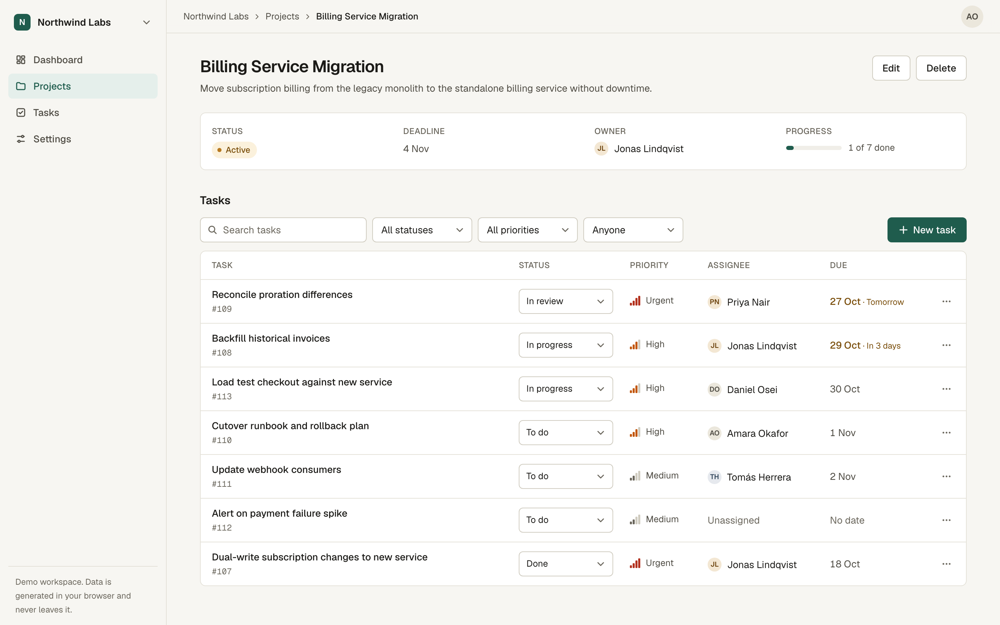
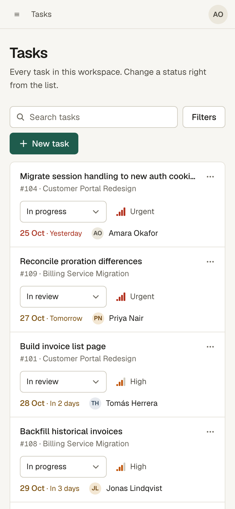

# FlowBoard

Project and task management for small software teams. FlowBoard is a front-end portfolio project built to production standards: typed API layer, accessible components, responsive layouts, tests, CI and a hardened Docker image.



> **Demo notice.** There is no backend. Data comes from a mock API that runs in the browser and is saved to `localStorage`. There is no real authentication; the signed-in user is a fixture. See [Known limitations](#known-limitations).

## Features

- **Dashboard**: task counts by status, upcoming and overdue deadlines, recent projects, recent activity. Every figure is computed from the data, and each panel has loading, error and empty states.
- **Projects**: list and detail views, create and edit, status and deadline, search, status filter, delete with confirmation. Progress is derived from the project's tasks.
- **Tasks**: create and edit, priority, status, assignee and due date, search and filters (status, priority, assignee, project), inline status change with optimistic update and rollback, delete with confirmation.
- **App shell**: responsive sidebar that becomes a drawer on mobile, breadcrumbs, workspace switcher, user menu, skip link.
- **Filters live in the URL**, so a filtered view can be shared or reloaded.
- **Demo controls** (Settings): simulate network failures to see error states and rollback, or reset the sample data.

| Projects                                   | Tasks                                |
| ------------------------------------------ | ------------------------------------ |
|  |  |

| Project detail                                         | Mobile                                                                          |
| ------------------------------------------------------ | ------------------------------------------------------------------------------- |
|  |  |

## Tech stack

Next.js 16 (App Router) · React 19 · TypeScript (strict, `noUncheckedIndexedAccess`) · Tailwind CSS 4 · TanStack Query · React Hook Form + Zod · Vitest + Testing Library · ESLint · Prettier · Docker · GitHub Actions.

Deliberately not used: a component library, an icon library, a charting library, global state management.

## Getting started

Requires **Node.js 22.23.4 or newer** (`.nvmrc` pins it). Earlier Node releases, including all of 20.x, are end-of-life and do not include the fixes from the October 2026 Node.js security release.

```bash
nvm use            # picks up .nvmrc
npm ci
npm run dev        # http://localhost:3000
```

Copy `.env.example` to `.env.local` if you want to change the data source. The defaults need no configuration.

## Commands

| Command                           | Purpose                     |
| --------------------------------- | --------------------------- |
| `npm run dev`                     | Development server          |
| `npm run build` / `npm start`     | Production build and server |
| `npm run lint`                    | ESLint                      |
| `npm run typecheck`               | TypeScript, no emit         |
| `npm test`                        | Run the test suite once     |
| `npm run test:watch`              | Tests in watch mode         |
| `npm run format` / `format:check` | Prettier write / verify     |

CI (`.github/workflows/ci.yml`) runs lint, typecheck, format check, tests and the production build.

## Docker

```bash
docker build -t flowboard .
docker run --rm -p 3000:3000 flowboard
# or
docker compose up --build
```

The image is a three-stage build (dependencies, build, runtime) on a pinned `node:22.23.4-alpine`. The runtime stage contains only Next.js standalone output, runs as a non-root user, and has a health check. `NEXT_PUBLIC_*` values are inlined into the browser bundle at **build** time, so pass them as build args, and never put secrets in them.

For deployment, run the image behind any HTTPS-terminating proxy or container platform. Nothing else is required in mock mode.

## Project structure

```
src/
  app/                 Routes, root layout, providers. (app)/ holds the authenticated shell.
  components/
    ui/                Design-system primitives: Button, fields, Dialog, DropdownMenu, Toast, badges
    layout/            App shell, sidebar, breadcrumbs
    forms/             Field wrapper, debounced search, API-error-to-form mapping
    feedback/          Empty, error and query-state components
  features/
    projects|tasks/    components/ · hooks/ (React Query) · services/ (API calls) · schemas/ (Zod + types)
    dashboard/         Summary logic and view
    activity|workspace/
  lib/api/             ApiClient interface, HTTP adapter, ApiError
  lib/utils/           Date helpers, class names
  mocks/               In-browser mock backend: seed data, route handlers, mock client
  hooks/               Shared hooks (URL-synced filters)
  test/                Test setup and render helper
```

Data flows one way: **component → hook → service → `api` client**. Components never call `fetch` or know where data comes from.

## Architecture decisions

- **One seam for data.** `ApiClient.request(path, schema, options)` is the only thing the UI depends on. Every response is parsed with a Zod schema, so a malformed payload becomes an `invalid_response` error instead of a runtime crash.
- **Zod schemas are the single source of truth** for types, form validation and response validation. The mock backend validates input again on its side, as a real server would.
- **TanStack Query** is used because several views share the same data (dashboard, lists, detail) and need cache invalidation after mutations. Task status changes are optimistic and roll back on failure.
- **One error shape.** All failures become an `ApiError` with a code, status and optional field errors. Forms map field errors back onto inputs; everything else surfaces as an alert or toast. Only transient failures (network, 5xx) are retried.
- **Client-side data views.** The mock data lives in the browser, so server-side prefetching would have nothing to fetch. Route files and layouts stay Server Components; data views are Client Components. With a real backend, you would prefetch in the server components and hydrate the query cache.
- **Native elements first.** Modals use `<dialog>` (focus trapping, Escape, inert background come from the platform), selects are native `<select>`, so keyboard and mobile pickers just work. The only custom widget is the menu button, which implements the WAI-ARIA menu button keyboard pattern.
- **Design tokens** live in `src/app/globals.css` as CSS variables mapped into Tailwind's theme: warm neutral surfaces, one pine-green accent, muted semantic colours for status and priority. Status and priority are always shown with text or shape as well as colour.
- **Responsive tables.** Lists render as a table when their container is wide enough and as stacked rows otherwise (container queries), instead of scrolling horizontally on phones.

## Mock API and moving to a real backend

`src/mocks/` implements a REST-style API (`GET /projects`, `PATCH /tasks/:id`, ...) over an in-memory database seeded with sample data and mirrored to `localStorage`. It adds latency, validates input, returns 404/422 errors, and records activity, so the UI exercises realistic behaviour.

To connect a real backend:

1. Set `NEXT_PUBLIC_API_MODE=http` and `NEXT_PUBLIC_API_BASE_URL` at build time. `src/lib/api/http.ts` already implements the client with typed errors and response validation.
2. Match the endpoint paths and response shapes in `src/features/*/services` (or adjust the services, which is the only place paths appear).
3. Add authentication in `createHttpClient` (cookies or tokens), and replace the `/me` fixture.
4. Remove `src/mocks` and the demo controls. In HTTP mode they are not loaded, but they are still in the repository.

## Testing

```bash
npm test
```

The suite is intentionally small and targets behaviour that matters:

- form validation rules (schemas) and server-side field errors shown next to inputs
- double-submit prevention on the task form
- delete confirmation: cancel does nothing, confirm deletes, failure keeps the dialog open
- optimistic status update and rollback on failure
- HTTP client error normalisation (network, 404, 5xx, malformed response)
- mock API behaviour (validation, cascading delete, filtering) and deadline logic

Automated accessibility checks (axe, WCAG 2.1 A/AA) were run manually against every route and the open task dialog with no violations. This does not replace testing with a screen reader.

## Known limitations

- **No authentication.** The current user is a fixture. Nothing in this repository is protected, and client-side validation is for usability only, not security.
- **Data is local to one browser.** `localStorage` is the persistence layer, so there is no sync between devices or users, and clearing site data resets it.
- **Workspace switching** filters mock data by workspace but does not model permissions.
- **No pagination or drag-and-drop board view**; the data set is small and the list view covers the core workflow.
- Dates are calendar days without time zones.
- Automated accessibility checks do not cover everything; manual screen-reader testing has not been done.
